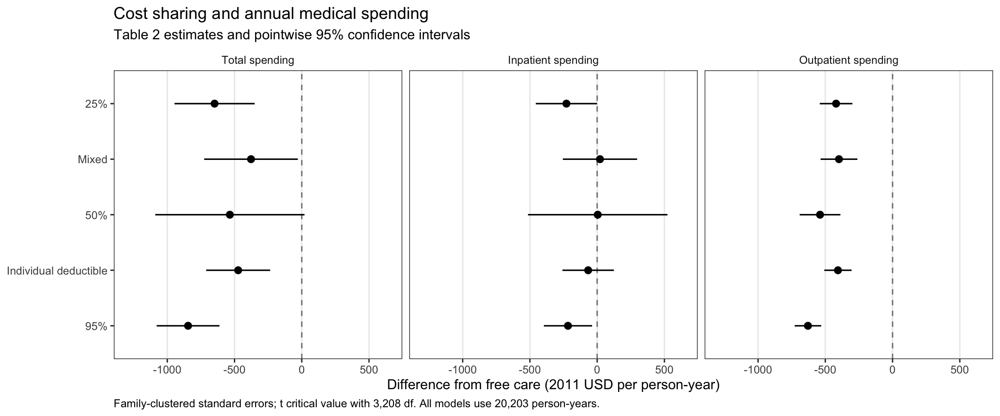

# RAND Health Insurance Experiment: Replication in R

This repo replicates Table 2 and part of Table 3 from Aron-Dine, Einav, and Finkelstein (2013), *The RAND Health Insurance Experiment, Three Decades Later*, Journal of Economic Perspectives 27(1): 197-222.

- [Paper](https://doi.org/10.1257/jep.27.1.197)
- [Authors' data and Stata code](https://doi.org/10.3886/E113919V1)

## Question

When patients pay part of their medical bill, do they use less care? Does total spending fall?

The RAND experiment randomly assigned families to insurance plans. One plan gave free care. The others made patients pay part of the cost. Free care is the comparison group.

## How to run

Install the packages once:

```r
install.packages(c("foreign", "dplyr", "broom", "sandwich", "ggplot2"))
```

Start R in this folder (the scripts use relative paths), then run:

```r
source("run_all.R")
```

From a terminal in this folder, `Rscript run_all.R` does the same. All output goes to `results/`.

## Files

| File | What it does |
| --- | --- |
| `run_all.R` | Runs every script below, in order |
| `replicate_table2.R` | Fits the six Table 2 regressions |
| `table2_inference.R` | Family-clustered standard errors, the free-care level, and the joint F test |
| `export_results.R`, `table_output.R` | Compare with the paper; round and save the tables (CSV, PDF, LaTeX) |
| `replicate_table3.R` | Table 3 sensitivity checks |
| `summarize_data.R` | Sample size and spending summary |
| `plot_results.R` | Figure of plan effects with 95% confidence intervals |
| `validate_results.R`, `validate_table3.R` | Recompute the standard errors a second way, as a check |
| `data/` | The authors' cleaned dataset |
| `original/` | The authors' Stata code, unchanged |
| `reference/` | Published values and notes on sources |
| `results/` | All output |

## Data and model

- 20,203 person-years from 5,915 people in 3,209 families. One row is one person in one year.
- Six outcomes: any spending, and the amount spent, for total, inpatient, and outpatient care. Amounts are in 2011 dollars.
- Each outcome is regressed by OLS on plan dummies (free care is the base), site × enrollment month, and enrollment year (`fam_start_year`, not the experiment-year index `year`).
- Standard errors are clustered by family. The joint test of the five plan effects uses F(5, 3208).
- The paper's free-care row is not the regression intercept. It is the predicted free-care level at the sample's average site and enrollment timing. `table2_inference.R` computes it.

## Table 2 results

All 78 numbers match the paper: 36 estimates, 36 standard errors, and 6 joint p-values.

Two of them match only if you round in two steps, the way the authors' Stata export (`esttab`) rounds:

- Inpatient spending SE, 50% plan: 264.495 → 264.5 → 265 (direct rounding gives 264).
- Inpatient spending joint p-value: 0.15386 → 0.154 → 0.1540 (direct rounding gives 0.1539).

This two-step rule is my best explanation. I could not confirm it, because I did not run the authors' Stata code. The evidence is in `reference/evidence.txt`.

What the results say, for the 95% coinsurance plan compared with free care:

- The chance of any spending is 17 percentage points lower.
- Total spending is $845 lower per person per year. Free care averages $2,170, so this is about 39% less.
- Outpatient spending is lower under every plan. For inpatient spending, the five plans are not jointly significant (p = 0.154).



## Table 3 sensitivity checks

Patients who pay more of the bill may file fewer claims. Then the records would miss some of their care, and the drop in spending would look too large. The paper checks this with three versions of the 95% plan versus free care:

| Version | Any total spending | Total ($) | Inpatient ($) | Outpatient ($) |
| --- | ---: | ---: | ---: | ---: |
| Original model | −0.170 | −845 | −217 | −629 |
| Correct for missing claims | −0.100 | −786 | −217 | −582 |
| Correction + pre-experiment controls | −0.095 | −728 | −183 | −558 |

All 18 estimates and 18 standard errors match the paper. The drop gets smaller but stays negative.

- The claim correction scales outcomes by a fixed factor for each plan, taken from the authors' code. After this, "any spending" is no longer 0 or 1. Details are in [reference/table3_notes.md](reference/table3_notes.md).
- The regressions use all 20,203 person-years, as the authors' code does. The 10,564 in the paper's panel heading is only the count of the two plans being compared.
- `replicate_table3.R` saves a large file, `results/table3_models.rds`, that is not in git. Run that script before running `validate_table3.R` on its own.

## Not covered

- Building the data from the raw RAND files. This replication starts from the authors' cleaned data.
- Table 3 log outcomes, Panels B and C, and the bounds for people who left the study.
